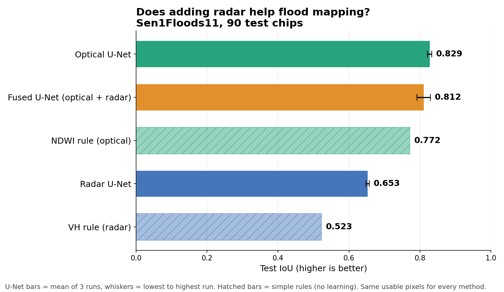

# Does adding radar help flood mapping? U-Nets on Sentinel-1 + Sentinel-2 (Sen1Floods11)

I trained flood-mapping U-Nets on three kinds of input (optical only, radar only, both stacked) and compared them with two simple rules that use no learning. Every number below comes from the same notebook, scored on the same pixels.

## TL;DR

- **Learning beat the simple rules for both sensors:** optical +0.057 over NDWI, radar +0.130 over a VH threshold.
- **Radar alone is stable but well behind optical:** about 0.65 against 0.83 test IoU.
- **Adding radar to optical gave no gain in this experiment**, and the fused model was less consistent from run to run. I did not find evidence that radar helped here. I am not claiming it hurts, because three runs per model is a small sample and the ranges overlap.

## Results (test IoU, 90 test chips)

| Method | Mean test IoU | Lowest | Highest | Runs |
|---|---|---|---|---|
| NDWI rule (optical), cut-off 0.0 | 0.772 | n/a | n/a | 1 |
| VH rule (radar), cut-off -24 dB | 0.523 | n/a | n/a | 1 |
| **U-Net, optical only (13 layers)** | **0.829** | 0.821 | 0.833 | 3 |
| U-Net, radar only (2 layers) | 0.653 | 0.648 | 0.657 | 3 |
| U-Net, optical + radar stacked (15 layers) | 0.812 | 0.792 | 0.830 | 3 |

Per-run scores, best epochs and validation scores are in `results.csv`.

The two rules were tuned on the training chips only (NDWI: train 0.651, valid 0.672; VH: train 0.464, valid 0.488), then scored once on the test chips.

## What I did

**Data.** Sen1Floods11 (public bucket `gs://sen1floods11`): 446 hand-labelled chips from 11 flood events. Each chip is 512 x 512 pixels at 10 m, with Sentinel-1 (VV and VH, in dB) and Sentinel-2 (13 bands) over the same area. Labels are 1 = water, 0 = not water, -1 = not labelled.

**Splits.** I used the train / valid / test lists published with the dataset: 252 / 89 / 90 chips. The 15 Bolivia chips are in none of the three lists, so they were not used.

**Usable pixels.** A pixel counts only if a person labelled it, the radar has a reading there, and the optical image is not empty there. Every method, rules and U-Nets alike, is scored on exactly those pixels.

**Score.** Intersection over union (IoU) of the predicted water and the labelled water, pooled over all test pixels. Water is only about 10.6% of labelled pixels, so plain accuracy would be misleading.

**Simple rules.** NDWI = (Green - NIR) / (Green + NIR), water if above a cut-off. VH radar, water if below a cut-off in dB. I tried a list of cut-offs, picked the best on the training chips, and checked it on validation and test.

**Model.** U-Net with a ResNet34 encoder (ImageNet-pretrained) from `segmentation-models-pytorch`. Same settings for all three input types: 30 epochs, batch 8, random 256 x 256 crops with flips, Adam at 1e-3, loss = binary cross-entropy + Dice, counted only on usable pixels. The best epoch is chosen on the validation chips. The test chips are scored once per run. Each run takes roughly 5-6 minutes on a Colab GPU.

**Repeats.** Three seeds per input type.

## Fairness rules built into the notebook

1. Cut-offs and the best epoch are chosen on train and validation chips only.
2. Test chips are scored once per run.
3. Every method is scored on the same usable pixels.
4. Only the input layers change between the three U-Net experiments. Nothing else is tuned per input type.

## What the runs showed

- **Run-to-run noise is real.** Validation IoU swings a lot between epochs (for optical it typically sits around 0.74 and peaks near 0.80). The best-epoch score is the top of a noisy line, so the test score is the number to trust.
- **Same seed did not reproduce exactly on a GPU.** An earlier set of optical runs with the same code gave test scores of 0.799 to 0.827, against 0.821 to 0.833 in the final set. I treat differences below about 0.03 as noise.
- **Data notes:** about 10% of chips (46 of 446) have blank radar readings, and about 94% of the blank radar pixels are also unlabelled, so dropping them costs very few labelled pixels.

## Limitations

1. **Label origin.** The labels were made with help from Sentinel-2 imagery, so optical inputs may have an advantage. The result may not hold for labels made another way.
2. **Cloud was not tested.** Radar's main advantage is seeing through cloud, and I did not simulate cloud-covered optical images.
3. **One fusion design.** I only tried early fusion (stacking all layers). Other designs, such as separate encoders per sensor, may behave differently.
4. **Same events in train and test.** The test chips come from the same flood events as the training chips, which is easier than predicting a flood in a new region.
5. **Small sample.** Three runs per input type shows whether the ranges overlap, not a precise difference.

## What I would test next

- Hide parts of the optical image to simulate cloud, and compare optical-only with fused.
- Hold out a whole flood event for testing.
- Try a fusion design with separate radar and optical encoders.

## Reproduce

1. Open `F1_flood_SAR_optical_complete.ipynb` in Google Colab and choose Runtime -> Change runtime type -> a GPU.
2. Run Part 0 to Part 5 in order. Part 0 downloads the data from the public bucket `gs://sen1floods11`.
3. For one input type at a time, set `MODE` to `"s2"`, `"s1"` or `"both"` in Part 1, then run Parts 6A and 6B. For everything at once, set `RUN_ALL = True` and run only Part 6C (about 50 minutes for 3 seeds x 3 inputs).
4. Run Part 7 for the summary table.

## Files

| File | What it is |
|---|---|
| `F1_flood_SAR_optical_complete.ipynb` | The whole project, with a remark beside every code line |
| `results.csv` | One line per run: input type, seed, encoder, weights, epochs, best epoch, validation IoU, test IoU |
| `results_chart.png` | The chart above |

## Data source and citation

Bonafilia, D., Tellman, B., Anderson, T., Issenberg, E. (2020). *Sen1Floods11: a georeferenced dataset to train and test deep learning flood algorithms for Sentinel-1.* CVPR Workshops.

## Author

Venkataramanaiah Poliboyina. 25 years of infrastructure survey experience, now working in GeoAI and remote sensing.
[GitHub](https://github.com/Venkataramanaiah-P) | [LinkedIn](https://www.linkedin.com/in/venkataramanaiahpoliboyina)
